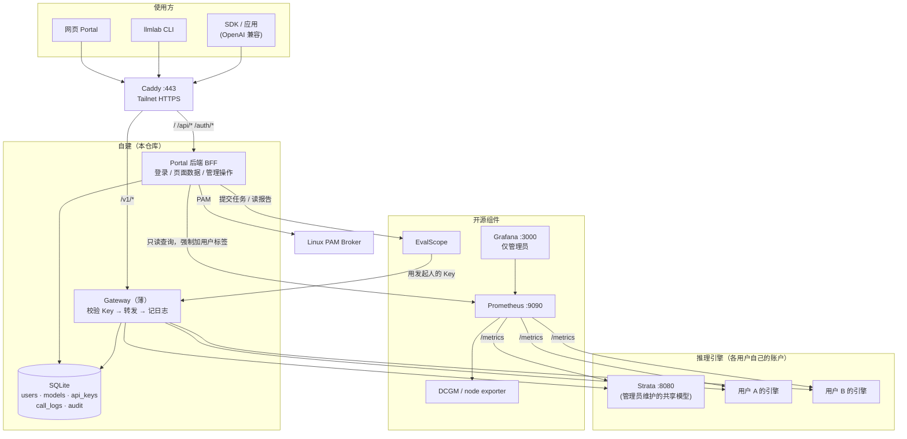

# LLM Lab 平台 V1 简化架构方案

## 当前阶段（2026-10-27）

本节覆盖下方旧提案中有关共享、权限与自动登记的决定。当前交付边界是个人资源管理：各人在自己的 Linux 身份下启动推理进程，平台负责发现、登记、只读监控、API 接入与本人主动发起的测试。跨用户共享留待后续版本。

| 对象 | 含义 | 当前行为 |
|---|---|---|
| 模型 | 权重文件或目录 | Agent 读取有界元数据及首尾摘要；按 owner、路径、内容摘要 / inode 识别移动和副本；多位置保留在同一个模型下 |
| 推理引擎 | 安装的框架和环境 | 原始安装文件保留；同一环境的可执行文件、Python 包与对应源码目录合并展示；显示最后观测时间 |
| 推理服务 | 正在监听的进程 | 服务端校验监听 UID，归入对应平台账户；完整上报确认消失才标离线，超过 30 分钟未更新标为观测过期 |
| API 接入 | 本人服务的 API 名称与上游模型映射 | 本人显式创建；默认私有，旧的共享记录也不能在个人模式下跨用户调用；不会再启动一份引擎 |

生产构建 `registry_mode=live` 默认启用 `personal_mode`。合成与历史测试保持原契约，便于验证旧模块；这不是生产共享开关。管理员可看资源和调用元数据，不能替别人修改服务参数、创建 API、撤销个人密钥或读取请求正文。旧的全局引擎密钥管理入口在个人模式关闭。

| 发现的缺口 | 此次处理 | 尚需部署或后续实现 |
|---|---|---|
| 服务名与磁盘模型重复建档 | Agent 服务发现不再创建模型占位记录；同名文件不能在缺少内容证据时被合并 | 旧的不同名占位行保留，避免破坏既有引用；不做猜测性删除 |
| 模型移动后重复登记 | 保留模型 ID、名称、说明和位置历史；完整且未截断的扫描才标记范围内缺失 | 仅覆盖配置的扫描根目录；摘要是有界采样，不是全量校验和 |
| 安装环境重复显示 | 合并同一环境的安装表现形式，保留展开查看的路径 | 引擎跨目录安装的历史记录不自动删除；独立环境、版本与用户不混并 |
| 多用户上报只登记模型 | 校验 UID 后同步私有服务；运行状态和心跳过期贯通 API 与监控 | `/opt/llmlab` 下的系统库存扫描代码需随应用一起发布；本仓库修改不会自动覆盖 root 所有的副本 |
| 服务指标误指向固定 Strata | 新增按服务 ID 授权的指标读取，支持 Strata JSON、vLLM / SGLang Prometheus 指标，服务端注入对应凭据 | 实际引擎需运行并开放指标；SGLang 需启用 metrics；没有数据保持未知 |
| 插件仅有静态跳转 | 六插件目录；Prometheus/Grafana 实际探活，EvalScope 健康与执行能力分开；引擎按本人服务显示 | 插件跳转地址仍由管理员配置；执行服务未就绪时不能启动评测 |
| 评测只有空态 | 新建评测、执行记录、数值结果、失败 / 超时 / 重启状态、本人核对、幂等与并发限制 | 已适配本机 1.12 执行接口；真实模型负载和数据集仍需小样本验收，详见评测文档 |
| 监控单调与文字遮挡 | 环形、柱状、散点、显存旭日图；缩短图心文字，保留完整图例；响应式网格、换行与图标不压缩 | 不凭空补历史趋势；历史留存继续由 Prometheus / Grafana 提供 |
| 模型类型写死为 LLM | 模型保留 kind/task/size，展示对话、视觉、图像、视频、向量等分类 | 当前 API 测试与新增评测面向 OpenAI 兼容 LLM；图像/视频/JEV 的执行、日志结构与评测适配器留待专门实现 |

平台保存登记元数据、本人 API 调用元数据和本人评测数值摘要。请求正文默认不保存，调用者可按自己的密钥开启有限期保存。权重、引擎安装和进程仍由 Linux 所有者控制。平台保存启动参数后只给出参数参考，由本人合并进原启动配置并重启，不能把“保存配置”显示成“已经重启”。

发布验证应分开记录：源码回归、浏览器交互、BFF 重载、系统 Agent 更新、外部引擎 / EvalScope 的真实执行。此前的共享池和按需启动设计属于后续阶段，不是本次已具备的能力。

系统 Agent 使用 root 所有的 `/opt/llmlab` 副本。本机 `sudo -n` 要求交互认证，因此工作区更新后还需要管理员在仓库根目录执行一次：

```bash
sudo bash deploy/inventory/update-runtime.sh
```

脚本先暂停扫描定时器；如已有扫描在运行则退出并恢复定时器。更新前把原有 `backend`、`cli` 备份到 `/var/backups/llmlab-inventory`，只同步这两个代码目录，再触发一次扫描，退出时恢复原来启用的定时器。配置、数据库和用户目录不在同步范围内。

### 资源监控延迟修复（2026-10-27）

此前每个访问者都会触发一次主机采样，最短采样窗口在锁内串行等待；前端又要等服务清单、GPU、主机三份请求全部完成，才挂载页面并整页重绘。现将同一轮主机快照复用 0.5 秒，保留原始采样时间；页面立即挂载，各数据源独立更新，服务清单改为每 15 秒读取。图表切换控件保持原节点，图例刷新恢复键盘焦点；离开页面取消读取并清理定时器。

同机对比：8 个并发主机读取从总计 4.106 秒降为 0.651 秒，且返回同一份采样；复用期读取约 0.28 毫秒。浏览器人为将服务清单延迟 1.5 秒、主机响应设为 30 毫秒时，页面挂载从 1,518 毫秒降到 5 毫秒，首份主机数据约 44 毫秒出现。浏览器数字来自受控延迟测试，不包含用户到服务器的网络往返。

### 结论自洽修复（2026-10-27，产品定义 M0）

按 [产品定义](product-definition-2026-10-27.md) §5 修掉三处「说了假话」：

| 项 | 之前 | 现在 |
|---|---|---|
| 服务状态 | `status == verified` 直接显示「运行中 · 健康」，与此刻在不在跑无关 | 只有在 30 分钟窗口内被确认过（发现循环见到或探活拿到结论）才显示「运行中」，否则「未确认」并在状态下方写明「确认于 …」 |
| 健康 | 由 `status` 推断，探测记录里的 `degraded` 被覆盖 | `engine_record` 透传 Registry 的 `health` / `health_reason` / `health_observed_at`；没有探测记录时显示「未探活」，不编结论 |
| 保存参数 | 提示「已保存目标参数」，容易被读成已生效 | 提示「已保存目标参数，服务没有重启」，按钮旁常驻说明 |

同时收敛入口与名词：登记推理服务只保留一个主入口（「推理服务」页），发现记录里的候选改为带着端口/名称进同一个向导，不再有第二条登记流程；登记向导去掉从无效果的「访问范围」选项；`#/gateway` 的页内标题与导航统一为「调用统计」。

**补记（同日）**：推理服务列表里曾同时出现「服务行」和「部署行」。部署行的标签取的是模型名，所以一个端口看起来有两个服务，其中一行的状态永远填不出来（`deployment_record` 的 `resources` 恒为 `null`）。现在 `servicesFromOps` 只产出 `engines`；部署行搬进 `deploymentsFromOps`，只供概览页显存归因。列名「推理框架」改为「引擎」，名词「Agent」统一为「代理」（命令名 `llmlab agent` 保持字面）。详见产品定义 §4.3。

### 代理任务派发（2026-10-27，产品定义 M2）

服务详情页多了一块「服务控制」：启动 / 停止 / 重启。它**不是**平台代跑 —— 平台只把任务排进**服务所有者本人**的队列。

| 环节 | 入口 | 结果 |
|---|---|---|
| 下发 | `POST /api/v2/registry/engines/{engine_id}/serve`，请求体只有 `kind`（`start`/`stop`/`restart`），可带 `unit` | **202**，`state=queued`。`argv`/`uid`/`owner`/`principal` 这类自报字段一律 400：执行入口只能来自服务端 |
| 领取 | 本机 `llmlab agent --watch` 经 `/run/llmlab/agent.sock`（`SO_PEERCRED` 给 uid），原子领取 | `queued` → `running`，并发领取不会拿到同一条 |
| 执行 | 代理以**自己的 Linux 身份**跑 `systemctl --user …` | `done` / `failed`，`failed` 也带结果对象，不吞 |
| 回报 | 代理 socket 回执；页面 `GET /api/v2/registry/agent-tasks/{task_id}` 轮询 | 只有 `done` 才说「代理已执行」 |

两条此刻最容易写错的规则：

* **「已下发」不是「已启动」。** 202 + `queued` 只说明任务进了队列；页面在拿到 `done` 之前不说「已启动」，等不到结果就说「确认你的代理在跑」，不把没有结论说成结论。
* **归属是字符串全等，所以两侧必须是同一个主体。** 任务的桶由 `engine.owner_uid`（登记时**观测到**的监听 uid）决定，写侧见 `RegistryService._agent_uid_for`；读侧见 `_task_uids_for` —— 平台账户没有 uid，只能把目录里的桶看一遍，但每条仍要求 `requested_by` 与调用者全等。对不上就 fail closed：没有可用的本人代理时返回 403，不猜一个 uid 投出去。

实测（2026-10-27，一次性临时环境：临时 state-dir、临时端口、假监听进程，不碰运行中的 BFF 与 systemd）：

| 步骤 | 实测结果 |
|---|---|
| 登记 | 所有权 prover 读到监听进程 `uid=1000 linux_user=fjd`，登记行 `owner_uid=1000`，所有者是平台账户 |
| 下发 | **202**，`state="queued"`，`result=null`，`payload` 只有 `kind`/`engine_id` |
| 领取 | 代理以 uid 1000 连 socket，任务转 `running` |
| 回报 | `failed`，`result={"error":"这一行没有可执行入口"}` —— 故意不给 `unit` |
| 越权读 | 另一个账户读同一条 → **404** `registry.not_found` |

`running` 窗口在「没有可执行入口」这条路上只有毫秒级，HTTP 轮询通常只抓到 `queued` 和 `failed`；上面的 `running` 是靠测试侧给回报连接加了 2 秒延迟读到的，不改变任务语义。

本机现状（2026-10-27 起）：`llmlab-bff.service` 在 `/run/llmlab/agent.sock` 上监听，常驻代理 `llmlab-agent.service` 每 60 秒上报一轮并领取任务（两者都是 fjd 的 user unit，从工作树直接运行，改完代码要 `systemctl --user restart` 才生效）。

仍然没走过的只有最后一段：**真正的 `systemctl --user` 起停**。本机唯一一条 engine 行是手工登记的 strata，`owner_uid` 是哨兵值 `-1` —— 平台没观测到它运行在哪个 Linux 用户下，所以下发会被按设计拒绝（fail closed），页面显示「没有可用的本人代理」。要让这段真正跑一次，需要一条由登记时的所有权证明写下 `owner_uid` 的服务行。

**日期**：2026-10-17 · **状态**：提案（Draft），待评审 · **适用**：单台 Dell Precision 5820（RTX A6000 48 GB）、多 Linux 用户

本文是在 [`architecture.md`](architecture.md) 基础上的**收敛版**：保留身份、数据真实性和安全边界，砍掉 V1 不需要的复杂度。两份文档冲突时，以本文的「已定决策」为准；本文没提到的细节沿用 `architecture.md`。

---

## 0. 已定决策（产品负责人，2026-10-17）

| # | 问题 | 决定 | 对架构的影响 |
|---|---|---|---|
| D1 | 推理引擎由谁启动 | **每个用户在自己的 Linux 账户下自行启动**，到平台登记 | 平台不启停 GPU 进程，只做登记、健康检查、监控和路由 |
| D2 | API Key 权限粒度 | **Key 绑定可调用的模型列表**；能过期、能撤销 | 不做「把我的 Endpoint 共享给某人」的逐人 ACL；用「模型可见性 + Key 的模型白名单」代替 |
| D3 | 限额 / 限流 | **V1 不做，只记录** | Gateway 无配额状态；用量只用于展示和审计 |
| D4 | Gateway 职责 | **只做三件事：校验 Key → 转发 → 记日志** | Gateway 是一个很薄的反向代理，不承担登记、编排或计费 |

---

## 1. 产品一句话

一台 GPU 机器上的**多用户模型服务平台**：用户自己跑推理引擎、登记成模型、生成 API Key；平台统一转发调用、记录每次调用、监控 GPU 和引擎、跑评测。

**不做**：GPU 调度器、集群管理、远程 shell、权重文件管理、按 Token 计费。

---

## 2. 总体架构



**一条原则**：开源组件只做它擅长的事。**「谁是谁、能调用什么、调用了多少」只由自建部分（BFF + Gateway + SQLite）说了算。**

### 2.1 两个入口，路径分开

| 路径 | 谁用 | 认证方式 | 处理者 |
|---|---|---|---|
| `https://lab/…` 页面、`/api/*`、`/auth/*` | 浏览器、CLI 管理操作 | Linux 登录后的会话 Cookie（浏览器）/ 平台 Token（CLI） | BFF |
| `https://lab/v1/*`（OpenAI 兼容） | SDK、应用、CLI 的 `invoke`、EvalScope | **API Key**（`Authorization: Bearer sk-lab-…`） | Gateway |

管理和推理走不同的进程：Gateway 出问题不影响登录和查看，BFF 发版也不会打断正在进行的推理流。

---

## 3. 组件职责

| 组件 | 类型 | 负责 | 不负责 |
|---|---|---|---|
| **Caddy** | 开源 | HTTPS、按路径分流到 BFF / Gateway | 鉴权 |
| **Portal 后端（BFF）** | 自建 | PAM 登录与会话；模型登记与健康检查；Key 的签发、列表、撤销；查询调用日志；代查 Prometheus；提交评测；审计 | 转发推理请求 |
| **Gateway** | 自建，**薄** | 解析 Key → 判断 Key 是否有效、模型是否在白名单 → 转发到引擎 → 写一条调用日志 | 登记、配额、编排、存正文 |
| **SQLite** | 开源 | 唯一业务数据库（WAL 模式），BFF 读写、Gateway 读 Key/模型并写日志 | — |
| **推理引擎** | 用户自己 | 推理；暴露 OpenAI 兼容接口和 `/metrics` | 鉴权（只认 Gateway 持有的引擎密钥） |
| **Prometheus** | 开源 | 采集 GPU（DCGM）、主机（node_exporter）、引擎 `/metrics`、Gateway 指标 | 按用户鉴权 |
| **Grafana** | 开源 | 管理员看全局深度图表 | 普通用户的数据隔离（所以普通用户不进 Grafana） |
| **EvalScope** | 开源 | 跑评测、出报告 | 自己决定占 GPU、绕过 Gateway 直连引擎 |
| **llmlab CLI** | 自建 | 命令行完成登记、Key 管理、查看日志、调用 | — |

---

## 4. 数据模型（SQLite）

只有六张核心表。用户身份 = Linux UID，不用用户名字符串做主键。

```sql
-- 登录过的 Linux 用户（PAM 证明身份后自动建档）
users(uid INTEGER PRIMARY KEY, username TEXT, is_admin INTEGER DEFAULT 0,
      disabled INTEGER DEFAULT 0, created_at)

-- 模型 = 一个可被调用的服务入口（一个引擎可登记多个模型名）
models(id TEXT PRIMARY KEY,            -- 对外的模型名，如 "qwen3-8b-zhangsan"，全局唯一
       owner_uid INTEGER,              -- 谁登记的
       upstream_url TEXT,              -- 只允许 127.0.0.1:<白名单端口> 或 unix socket
       upstream_model TEXT,            -- 引擎内部的模型名
       upstream_secret_ref TEXT,       -- 引擎密钥的引用（明文不入库，见 §7）
       metrics_url TEXT,               -- 可选，供 Prometheus 采集
       visibility TEXT CHECK (visibility IN ('private','public')) DEFAULT 'private',
       status TEXT,                    -- registered / healthy / unhealthy / disabled
       last_check_at, created_at)

-- API Key：只存哈希，明文只在签发时显示一次
api_keys(id TEXT PRIMARY KEY, owner_uid INTEGER, name TEXT,
         prefix TEXT,                  -- 前 8 位，用于界面识别，如 sk-lab-3f9a…
         hash TEXT,                    -- SHA-256(明文)
         expires_at, revoked_at, last_used_at, created_at)

-- Key 能调用哪些模型（D2）
api_key_models(key_id TEXT, model_id TEXT, PRIMARY KEY (key_id, model_id))

-- 每次调用一行，只有元数据，没有 prompt / completion
call_logs(id INTEGER PRIMARY KEY, ts, request_id TEXT,
          key_id TEXT, caller_uid INTEGER, model_id TEXT, model_owner_uid INTEGER,
          path TEXT, stream INTEGER, status INTEGER,
          prompt_tokens INTEGER NULL, completion_tokens INTEGER NULL,   -- 未知为 NULL，不填 0
          ttft_ms INTEGER NULL, total_ms INTEGER, error TEXT NULL)

-- 管理操作审计：登记/删除模型、签发/撤销 Key、管理员操作
audit_log(id INTEGER PRIMARY KEY, ts, actor_uid, action TEXT, target TEXT, detail_json TEXT)
```

**可见性规则（替代逐人共享）**：

- `private` 模型：只有所有者的 Key 能绑定它。
- `public` 模型：任何用户的 Key 都能绑定它（例如管理员维护的 Strata 共享模型）。
- 所有者把模型从 `public` 改回 `private`，或删除/停用模型 → **别人已绑定的 Key 立即调不通**（Gateway 每次请求都实时检查，见 §5.3）。

> 如果以后确实需要「只共享给张三」，再加一张 `model_grants(model_id, grantee_uid)` 表即可，不影响上面的结构。现有 Registry 的 `endpoint_grants` 可以直接迁过来。

---

## 5. 关键流程

### 5.1 登记引擎和模型（D1）

```
用户在自己账户下启动引擎（例：vllm serve … --host 127.0.0.1 --port 8601 --api-key <引擎密钥>）
  → 网页「模型」页或 llmlab models register 提交：模型名、upstream_url、upstream_model、引擎密钥、可见性
  → BFF 校验：
       · upstream_url 只能是 127.0.0.1 + 端口白名单（拒绝 0.0.0.0、外网、:8080 以外的系统端口）
       · 端口当前的监听进程属于该用户的 UID（读 /proc/net/tcp + /proc/<pid>/status，
         防止把别人的引擎登记成自己的）
       · 用引擎密钥调一次 GET /v1/models，确认模型存在 → status = healthy
  → 写 models + audit_log
  → BFF 重新生成 Prometheus 的 file_sd 目标文件（见 §6.2）
```

后台每 30 秒做一次健康检查，更新 `status` 和 `last_check_at`。引擎挂了，页面显示 `unhealthy`，Gateway 对该模型返回 `503 model_unavailable`。

### 5.2 签发和撤销 API Key（D2）

```
网页「API 管理」→「新建 Key」：名称、有效期（默认 90 天）、勾选可调用的模型（只列出自己能看见的）
  → BFF 生成 sk-lab-<32 字节随机>，只存 SHA-256 哈希 + 前缀
  → 明文在弹窗中显示一次（复制按钮 + 「关闭后无法再次查看」提示）
撤销：写 revoked_at → Gateway 的下一次请求就会拒绝（缓存最多 10 秒，见 §5.3）
```

浏览器发起的写操作都要过 CSRF + Origin 校验（沿用现有 `backend/auth` 的实现）。

### 5.3 调用路径（Gateway，D3 / D4）

```
POST /v1/chat/completions   Authorization: Bearer sk-lab-…   {"model": "qwen3-8b-zhangsan", …}

1. 取 Key → SHA-256 → 查 api_keys（10 秒内存缓存，按哈希）
     不存在 / 已撤销 / 已过期 / 所属用户已停用     → 401 invalid_api_key
2. 查 model：存在、未停用、Key 的白名单包含它、
     且（visibility='public' 或 owner_uid = Key 的 owner_uid） → 否则 404 model_not_found
     （不可见的模型和不存在的模型返回同样的 404，不泄露别人的模型名）
3. 模型 status = unhealthy                         → 503 model_unavailable
4. 转发到 upstream_url：替换 Authorization 为引擎密钥，model 字段改写为 upstream_model；
     流式请求自动加 stream_options.include_usage = true，原样流回客户端
5. 结束（成功、失败或客户端断开）时写一条 call_logs：
     tokens 取响应里的 usage；拿不到就记 NULL；记录 TTFT 和总耗时
6. 暴露 Prometheus 指标：lab_gateway_requests_total{model,status}、
     lab_gateway_latency_seconds{model}（标签只用 model 和 status，不放 key/uid，控制基数）
```

**Gateway 支持的路径（V1）**：`/v1/models`（只列出这个 Key 能用的模型）、`/v1/chat/completions`、`/v1/completions`、`/v1/embeddings`。其他路径一律 404。

**实现建议**：一个约 300–500 行的 Python 异步服务（aiohttp 或 Starlette + httpx），单进程，systemd 托管，监听 `127.0.0.1:8300`。不引入 Redis、消息队列或配额状态。日志写入用一个后台队列批量插入 SQLite，不阻塞转发。

> **为什么不直接用 LiteLLM Proxy**：它能做 Key 和日志，但「Key 属于哪个 Linux UID、模型属于哪个用户、私有模型对别人返回 404」都需要在它外面再包一层，最后不比自己写这 400 行省事。Gateway 保持 OpenAI 兼容，将来真要换也容易。

### 5.4 查看自己的调用

网页「我的调用」或 `llmlab logs --mine` → BFF 查 `call_logs WHERE caller_uid = 当前用户`，支持按时间、模型、状态筛选和分页导出。模型所有者可以额外看到「别人调用我的模型」的汇总（只有次数和 Token 数，不含调用者明细之外的内容）。管理员可以看全部。

---

## 6. 监控设计

### 6.1 采集

| 数据 | 来源 | 采集方式 |
|---|---|---|
| GPU 利用率、显存、温度、功耗 | **DCGM exporter**（或 nvidia_gpu_exporter） | Prometheus 抓取 |
| CPU、内存、磁盘、网络 | **node_exporter** | Prometheus 抓取 |
| 每个用户占用的显存 | 自建小采集器：NVML 列出 GPU 进程 PID → `/proc/<pid>/status` 取 UID → 汇总 | 暴露 `lab_gpu_memory_bytes{uid}`，Prometheus 抓取 |
| 引擎指标（排队、吞吐、KV cache） | 各引擎自己的 `/metrics` | Prometheus 用 `file_sd` 抓取，目标由 BFF 根据 `models` 表生成 |
| 调用量、延迟、错误率 | Gateway 的 `/metrics` + `call_logs` 表 | 趋势图查 Prometheus，明细查 SQLite |

### 6.2 按用户归属

BFF 在模型登记、删除时重写 `/etc/prometheus/file_sd/lab-engines.json`，给每个目标打上 `owner_uid`、`model` 标签。Prometheus 每 30 秒重新读取，不需要重启。

### 6.3 谁能看什么

| 用户 | 看到的内容 | 实现方式 |
|---|---|---|
| 普通用户 | 整机 GPU 和主机概况（只读）+ **自己的**引擎、显存、调用 | BFF 代查 Prometheus，**强制追加 `owner_uid="<当前 UID>"` 标签过滤**；前端拿不到 Prometheus 地址 |
| 管理员 | 全部数据 + Grafana | Grafana 走 Caddy 的 auth 转发，只放行 `is_admin=1` 的会话 |

数据没有来源或已过期时显示「未接入 / 已过期」，**不显示 0**（沿用现有前端的诚实状态设计）。

---

## 7. 安全要点（单机多用户特有）

1. **回环地址不等于隔离。** 同一台机器上的任何用户都能访问 `127.0.0.1:端口`，所以：
   - 每个引擎必须设置自己的 API 密钥（vLLM `--api-key`，Strata 已有 `STRATA_API_KEY`），只有 Gateway 和所有者知道；
   - 更强的做法是引擎监听 unix socket，权限 `0660`、属组 `lab-gateway`。
2. **引擎密钥存放。** 登记时提交的引擎密钥由 BFF 写入 `/var/lib/llmlab/secrets/<model_id>`（权限 `0600`，属主是运行 Gateway 的服务账户）；数据库只存引用路径。
3. **防冒领端口。** 登记时校验监听进程的 UID = 登记人（§5.1）。
4. **Key 只存哈希。** 明文只显示一次；日志、审计、截图中都不出现明文。
5. **调用日志不存正文。** 只存元数据；用户自己有需要再在应用层保存。
6. **所有服务只监听 127.0.0.1。** 对外只有 Caddy `:443`（Tailnet 内），浏览器不能直连 `:8080` / `:9000` / `:9090` / `:3000`。
7. **管理员 ≠ root。** Portal 管理员只能看数据、停用 Key 或模型、停用用户，不能在机器上执行命令。

---

## 8. EvalScope 集成

- 用户在「评测」页选择模型和数据集 → BFF 生成一个**仅绑定该模型、有效期 24 小时**的临时 Key → 把评测任务放进队列。
- 一个 Runner 进程**一次只跑一个任务**（单卡，避免和在线推理抢显存），EvalScope 通过 **Gateway** 调用（所以评测调用也会出现在调用日志里）。
- 报告存放在 `/var/lib/llmlab/reports/<uid>/<job_id>/`，只有发起人和管理员能看。
- 旧的 Benchmark 报告以「历史报告」只读列表展示，与新报告分开。

---

## 9. 部署拓扑（单机）

| 进程 | 运行身份 | 监听 | 托管 |
|---|---|---|---|
| Caddy | caddy | `:443`（Tailnet） | systemd |
| Portal 后端（BFF） | `llmlab` 服务账户 | `127.0.0.1:8400` | systemd |
| Gateway | `llmlab-gw` 服务账户 | `127.0.0.1:8300` | systemd |
| PAM Broker | root（最小化，仅 unix socket） | `/run/llmlab/pam.sock` | systemd |
| Prometheus / Grafana / exporters | 各自服务账户 | `127.0.0.1:9090` / `:3000` / exporter 端口 | systemd |
| EvalScope Runner | `llmlab-eval` | 无对外端口 | systemd |
| Strata（共享模型） | 管理员维护 | `127.0.0.1:8080` | 现有方式，不改 |
| 用户引擎 | 各用户自己 | `127.0.0.1:<白名单端口段，如 8600–8699>` | 用户自己（可用 `systemd --user`） |

Caddy 路由：`/v1/*` → Gateway；`/grafana/*` → Grafana（仅管理员）；其余 → BFF。

数据目录：`/var/lib/llmlab/{lab.db, secrets/, reports/}`。备份时只需备份这一个目录。

---

## 10. 与现有代码的对应关系

| 现有模块 | V1 处理 |
|---|---|
| `backend/auth`、`backend/auth_linux`（PAM、会话、scoped token） | **保留**。scoped token 作为 CLI 的「平台 Token」；新增 `api_keys` 作为调用 Key |
| `backend/registry`（engines/models/deployments/endpoints/grants/routing ACK） | **简化**：合并成一张 `models` 表 + 可见性；`deployments`、`endpoint_routings`（Router ACK）、`repoint/rollback` 推迟到 V2 |
| `backend/registry/gateway.py`（只读路由配置 + adapter） | **由新 Gateway 进程替代**。新 Gateway 直接读 SQLite，不再需要「配置契约 + ACK」两步 |
| `backend/atlas`（调用日志契约 `atlas-calls/1`） | **保留契约**，数据源改为 `call_logs` 表 |
| `backend/observability`（来源白名单、新鲜度） | **保留**，加上 BFF 代查 Prometheus 时的强制用户标签 |
| `backend/evaluation` | **保留**报告目录与 ACL；Runner 按 §8 接入 |
| `backend/bff` 路由表 | **保留**，按 §2.1 补齐 Key 管理和调用日志路由 |
| 前端 9 个页面（PR #62） | **保留**。API 管理页的「签发 / 撤销」在后端路由就绪后启用；图谱、评测排在后面 |

---

## 11. 里程碑（按依赖顺序，每一步都在真机上验收）

| 阶段 | 内容 | 验收标准 |
|---|---|---|
| **M1 只读监控** | Prometheus + DCGM + node_exporter + 每用户显存采集器；BFF 代查；概览和算力页接入真实数据 | 页面显示真实 GPU 数据，过期能正确显示「已过期」 |
| **M2 登录 + 模型登记** | PAM 登录；`models` 表；登记校验（端口属主、健康检查）；file_sd 生成 | 用户 A 登记自己的引擎，用户 B 看不到 A 的私有模型 |
| **M3 Key + Gateway** | `api_keys`；签发 / 撤销；薄 Gateway；`call_logs` | **V1 闭环**：A 签发 Key → 调用成功 → 日志记在 A 名下 → 撤销 → 下一次调用 401 |
| **M4 公共模型** | `public` 可见性；Strata 登记为公共模型 | B 的 Key 能调 Strata；A 把私有模型设为 public 后 B 能调，改回 private 后立即 404 |
| **M5 评测** | 队列 + Runner + 报告 ACL | 评测调用出现在日志中；报告只有发起人能看 |
| **M6 管理员与上线** | Grafana（仅管理员）、审计查询、备份、回滚手册 | 旧 Portal 功能等价后切换 |

**交付方式建议**：每个阶段一个小 PR，**当天合并到 main**；停止在长期草稿分支上层层叠加（目前约 100 个 PR 全部是 Draft，没有一个合并）。

---

## 12. 仍需确认的问题

1. **用户引擎的端口段**：是否就用 `8600–8699`？要不要强制用 unix socket？
2. **Key 默认有效期**：90 天是否合适？是否允许「永不过期」？
3. **模型所有者能否看到「谁调用了我的公共模型」**：只看汇总，还是能看到调用者？
4. **管理员名单**：是 Linux 用户组（如 `llmlab-admin`），还是在 Portal 里单独维护？（建议用 Linux 组，最简单）
5. **调用日志保留多久**：建议 180 天，超过的按月归档成 CSV。
