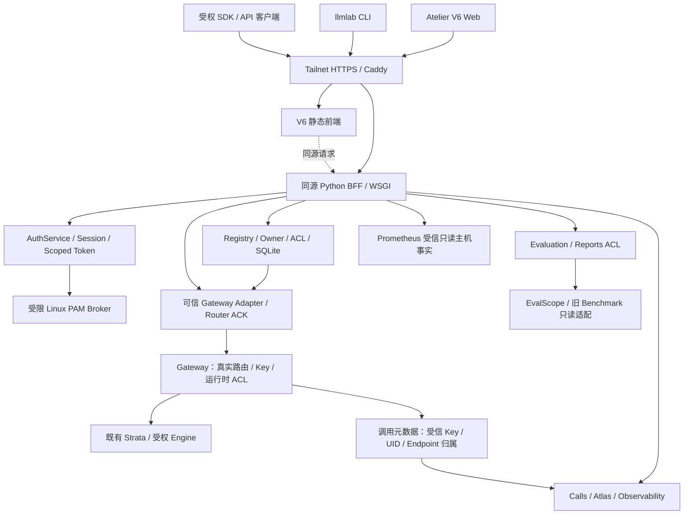
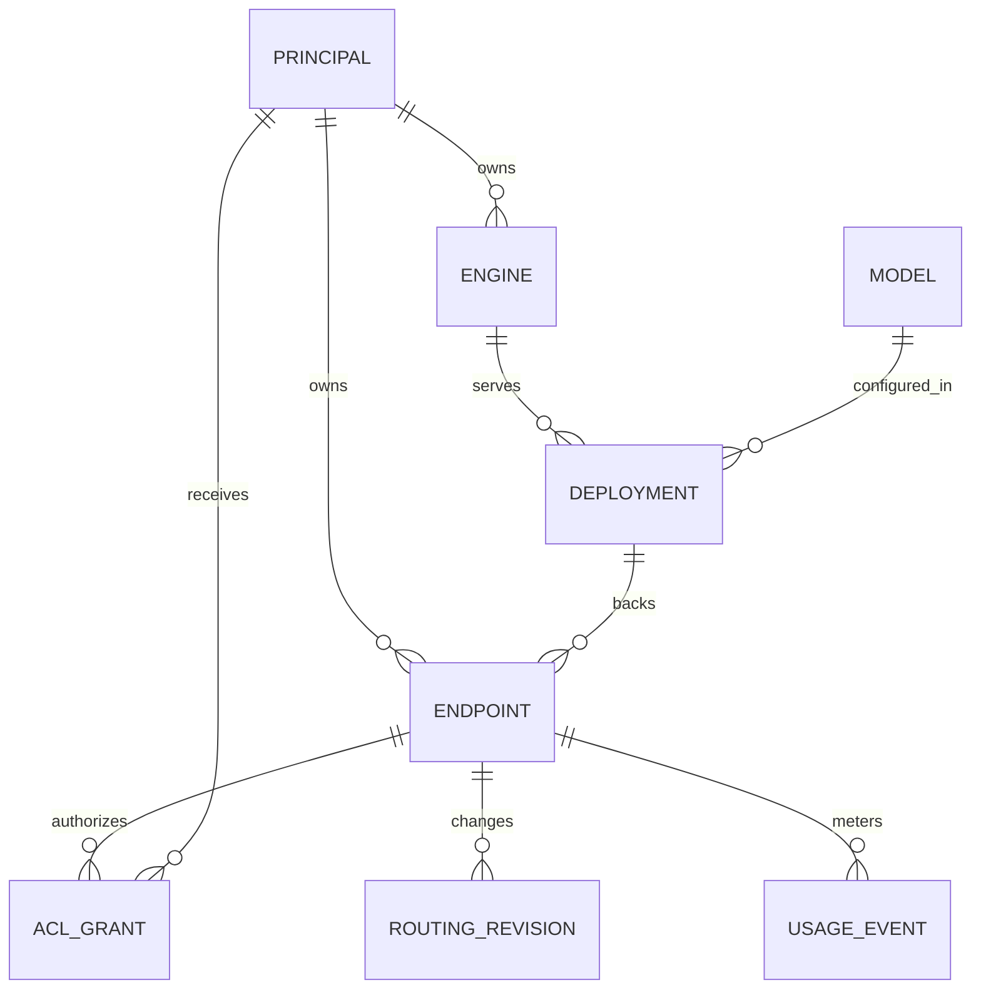
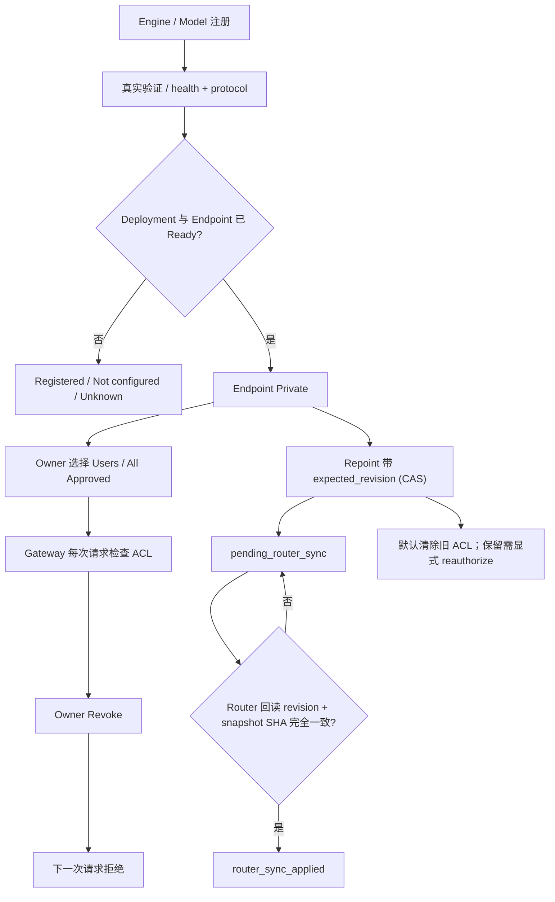

# Atelier V6 管理后台：产品需求与系统架构（V1）

> **2026-10-17 V1 execution baseline:** [V1 production architecture and acceptance documents](v1/README.md) extend this earlier architecture with V6.2 contract-first source inventory, authoritative UI/BFF/host boundaries, Linux-only agent placement, hourly dispatcher and CI-quota-independent local test gates. Earlier status snapshots in this file are dated and do **not** imply V1 is already deployed.
>
> **2026-10-17 更新**：产品负责人确定了 V1 的简化方向：用户自己启动引擎、Key 绑定模型列表、不做限额、Gateway 只做「校验 Key + 转发 + 记日志」。详见 [V1 简化架构方案](architecture-v1-simplified.md)。两者冲突时以简化方案的「已定决策」为准。

> **文档性质：目标架构 / 产品验收基线（供评审），不是部署记录或上线许可。**  
> 文档日期：2026-10-16；适用仓库：`ProfessorZhi/llm-lab-portal`。  
> 架构代码参考：[Phase B 集成候选 PR #60](https://github.com/ProfessorZhi/llm-lab-portal/pull/60)，commit `c941cd39555289f67d659ea0f4480ff360181825`；该候选并未合入 `main`，也未部署。  
> **已知版本差异：** UI [PR #54](https://github.com/ProfessorZhi/llm-lab-portal/pull/54) 随后更新到 `a33860e40327c458d6a1e24c7329aa309d4318b4`，修复主机 LIVE 新鲜度边界；PR #60 的 `c941cd3` 尚采用 UI 较早的 `e0d4ff8`，需要重新吸收并复跑回归，不能认为它已包含该修复。  
> 相关跟踪：[完整平台 #43](https://github.com/ProfessorZhi/llm-lab-portal/issues/43)、[九页内容 #56](https://github.com/ProfessorZhi/llm-lab-portal/issues/56)、[Phase B 集成 #59](https://github.com/ProfessorZhi/llm-lab-portal/issues/59)。

## 0. 阅读指南与状态语义

本文是 V6 **单节点、多 Linux 用户 LLM Laboratory Control Plane** 的产品与技术架构总入口。它统一此前散落的 UI、Auth、Registry、Gateway、Calls/Atlas、Observability、Evaluation 与 Release 契约；不以此覆盖各子模块的字段级规范。

| 标记 | 含义 |
| --- | --- |
| **TARGET** | 规划中的 V1 正式架构与验收要求 |
| **CODE / CPU-TESTED** | 仓库已有实现，且在离线或合成回环测试中验证 |
| **PREVIEW / HOST-LIVE** | 现有 8443 预览可访问，部分主机数据来自受信只读来源；并不证明用户级业务已运行 |
| **UNWIRED / BLOCKED** | 模块代码有了，但实际身份、上游、同源 API、凭据或部署未接通 |
| **ACCEPTED / GO** | 需独立 CI、浏览器、真实多用户和生产前复核证据；**目前不是此状态** |

**发布底线：代码存在 ≠ 同源接线 ≠ 实机运行 ≠ 生产验收。** 主机 GPU 利用率的真实读数也不等于用户用量、模型就绪或资源可调度。

## 1. 产品定位、用户和范围

### 1.1 产品目标

面向共享 Dell GPU 工作站上的实验室成员，提供两种一等入口：**Atelier V6 Web** 与 **`llmlab` CLI**。两者应复用同一受信 Linux 主体、Registry/Endpoint ACL、Gateway 运行状态与调用元数据，能完成：

- 查看**自己拥有**和**别人明确共享给自己**的模型服务；
- 登记 Engine / Model / Deployment / Endpoint，并验证服务确实可用；
- 共享、撤销及重指向稳定 Endpoint，不能把登记成功说成路由已经生效；
- 通过受权路由真实调用模型，查询自己的调用、用量与评测；
- 按来源与新鲜度观察 GPU、服务、Gateway 和按用户划分的指标；
- 在严格受控的管理员模式下审阅授权、审计和配置状态。

**V1 不定位为** Kubernetes 集群、通用 GPU 调度器、权重文件管理器、远程 root shell 或覆盖既有 Strata/旧 Portal 的运维代理。服务控制、模型自动调度和真实 GPU 评测执行可以作为独立的受控扩展；不能因此开放不可信写入口。

### 1.2 角色与动作边界

| 主体 | 可以做什么（必须另有对应 scope） | 不能因此做什么 |
| --- | --- | --- |
| 普通成员 | 登录、查询自己的资源与数据、使用已授权 Endpoint | 枚举他人资源、查看他人的调用原文 |
| Engine / Endpoint Owner | 登记并验证自己的部署；共享、撤销、审计自己的资源 | 代其他 Owner 改写其部署、访问家目录 |
| 被共享者 | 查看、调用授予自己的 Endpoint | 传递共享、替换 Owner 的模型或 ACL |
| 临时平台管理员 | 经明确提权后查看受许可的全局范围、执行单独授权的管理动作 | 自动成为 Linux root、自动获得任意 Owner 权限 |
| 主机运维者 | 通过单独维护流程管理 PAM、Caddy、系统服务和 GPU 生命周期 | 用 Web 管理员口令直接绕过系统维护流程 |
| CLI / 自动化主体 | 使用服务端签发的有限 scope Token 查询和调用 | 在命令行传输 Linux 密码或伪造 UID |

**身份（Authentication）与能力（Authorization）正交**。Linux 登录先证明主体是谁；某个动作是否可执行，还要由当前 Session/Token、scope、对象 Owner/ACL 和运行时状态共同决定。`role=admin` 这个字符串本身不能授权。

### 1.3 V1 最小业务闭环（最高优先级验收）

`A 登录 → A 登记 Engine/Model/Deployment → 验证 ready → A 创建 Endpoint（默认私有）→ A 共享给 B → B 用自己的 Token 调用真实模型 → Gateway 记录可归属 B 的元数据 → B 能看到自己的调用 → A 撤销 → B 下一次调用必被拒绝，操作可审计。`

至少验收：匿名与伪造身份拒绝；跨 UID 资源不可枚举；Token 到期/吊销/用户停用即时拒绝；Gateway ACL 是最终可执行权限；Registry 的路由 revision 只有在 Router 确认后才标已应用；用户级计量不混入主机级指标。

离线合成回环走通是**代码集成证据**，不能替代真实 Linux 用户、Gateway、Strata 和实际计量的结果。

## 2. 信息架构与九页产品功能

导航为 **8 个一级页面 + Compute 子页面**。所有一级页必须包含可识别的页面标题、真实业务区域、来源/更新时间及操作反馈，而不只是 Demo 卡片或一行 UNKNOWN。

| 页面 / 路由 | V1 最小可用内容 | 数据源 / 边界 |
| --- | --- | --- |
| **Overview** `#overview` | 主机/GPU 和服务健康；当前授权的模型、Endpoint；个人请求与错误概览、时间范围、告警、跨页快捷动作 | 主机事实与个人计量**分源**；不得默认绘制合成曲线或固定“已加载模型” |
| **Compute** `#compute`（Overview 子页） | GPU/VRAM、功耗/温度、CPU/RAM/磁盘、采样时刻、Engine 占用、历史曲线与只读/准入状态 | 受信主机事实；GPU 利用率为 0% 不代表显存有足够容量 |
| **Models & Chat** `#models` | Engine/Model/Deployment/Endpoint 列表、详情、Owner、健康、共享、revision；受权流式 Chat、取消、失败反馈 | Registry + Gateway；`registered ≠ ready ≠ routed` |
| **API Management** `#api` | Endpoint 接入信息、Key 一次签发/掩码/撤销/轮换、scope/到期/限额、可运行 curl/Python SDK、受权 Playground | Auth + Registry + Gateway；未接线时必须禁用发送 |
| **My Calls** `#calls` | 个人请求元数据，时间/模型/Endpoint/状态筛选、请求 ID、Tokens、延迟、分页、受权导出 | `atlas-calls/1`；精确绑定当前 Principal，不回传正文 |
| **Observability** `#observability` | 主机、Engine、Gateway、个人用量及延迟指标、历史窗口、来源/单位/过期信息、Grafana 受信入口 | Observability/Prometheus；整机与个人数据不能相互推断 |
| **Traffic Atlas** `#atlas` | 真实授权聚合、模型分布、工作负载、旭日图/矩形树图/热图/排名、详情与导出 | `atlas-usage/1` 与 `atlas-aggregate/1`；没接线是 UNKNOWN，不是 0 |
| **Evaluation** `#evaluation` | EvalScope 与旧 Benchmark **分源**目录、指标缺测、任务状态、报告详情、Owner 授权和受控导出 | Evaluation ACL；真实 Runner 不具备时只读，不虚构评分 |
| **Administration** `#admin` | 当前 Principal、Session 与 Scopes、项目/共享审计、限时管理模式、配置和服务状态 | Portal Session/ACL；管理员不等于 root，不复用匿名旧 API |

通用状态契约：**Loading、Ready、Authorized Empty、Not Configured、Denied、Stale、Unavailable、Error/Retry、Explicit Demo**。`null/UNKNOWN` 表示不知道或没量到，`0` 只表示确实测到零；`synthetic=true` 不得有 LIVE 徽章。每个可点击控件必须有真实事件/回执路径，或者显式 disabled + 解释。

通用交互质量：深链接（含旧 `#/compute` 兼容）、键盘焦点、明/暗主题、320/390/768/1024/1440 像素断点、无水平溢出，401/403/404/429/5xx、断线、重复点击、状态过期及撤销后 UI 清空均需验证。**九页业务深度仍单独由 [#56](https://github.com/ProfessorZhi/llm-lab-portal/issues/56) 验收**；页面骨架测试不是业务完成证明。

## 3. 当前运行路径与目标部署路径

### 3.1 已知预览与非生产代码

**PREVIEW（已存在的可访问入口，不是最终后台）：**

`Tailnet HTTPS :8443 → Sidecar Basic Auth + Host Allowlist → 127.0.0.1 静态 V6 → /api/infra/summary → Prometheus 只读投影`。

它的共享 Basic Auth 并不产生独立 Linux UID Session；能看到主机实时卡，不证明自己拥有某模型、某 API Key 或某次评测。现有 Strata/Gateway/旧 LAN Portal 要继续保留。

**Phase B 集成候选（[PR #60](https://github.com/ProfessorZhi/llm-lab-portal/pull/60)）**：七个 Lane 的 Python/Node 源码在隔离分支合成，使用合成 Principal、回环 Mock Gateway 做 CPU 安全 E2E。它未接入真实 PAM/Router/生产数据，未托管、未部署。源码当前与预览不是同一个发布版本。

### 3.2 TARGET 系统关系图



箭头说明的是**责任和计划中的可信路径**，不是每条 API 当前已接线。Web 浏览器不允许绕过 BFF 直接请求内部 `:8080`、`:8200`、`:9000` 等原始服务。非浏览器 SDK 若经受信 Gateway 入口调用，也必须按自己的 Token/Key 做相同 ACL 校验。

### 3.3 组件所有权

| 组件 | 源码位置 | 职责与非职责 |
| --- | --- | --- |
| Frontend | `prototypes/v6/**`、`web/js/**`、`web/css/**` | 展示状态、发同源请求；不签发上游密钥、不推断 Owner |
| Portal BFF | `backend/bff/**` | 统一路由、Host/Origin/CSRF、会话/Token 注入、聚合已授权 DTO；不相信客户端自报来源 |
| Linux Auth | `backend/auth_linux/**`、`backend/auth/**` | PAM broker 契约、User/UID、Session、Token 生命周期；不提供通用 root shell |
| Registry / CLI | `backend/registry/**`、`cli/llmlab/**` | Engine/Model/Deployment/Endpoint 登记、验证、共享、revision、审计；不读取权重或任意命令 |
| Gateway / Router | 本仓库可信适配层 + 并列仓库既有 Gateway | 验证用户可调用的路由、Key、最终 ACL、ACK、调用计量；Registry 的写库不代替 Router 生效 |
| Calls / Atlas | `backend/atlas/**` | 只聚合已核实归属的 metadata；`atlas-calls/1` 是个人调用视图而非项目汇总过滤版 |
| Observability | `backend/observability/**` | 来源白名单、单位、新鲜度、主机和个人指标区分；未接线不能凭 DTO 形状冒充 LIVE |
| Evaluation | `backend/evaluation/**` | 授权报告目录、EvalScope/Legacy 分源、受控评测准入；默认不触发真实 GPU Runner |
| Operations | `docs/atelier-v6-release-checklist-2026-10-16.md` 等 | 长期托管与回滚方案；代码 PR 不执行生产变更 |

## 4. 身份、授权与审计架构

### 4.1 受信身份路径

浏览器：`Linux 登录凭据（仅 HTTPS）→ 受限 PAM Broker → 校验真实 UID / account policy → AuthService 发 Session Cookie → CSRF/Host/Origin 检查 → BFF 绑定 Principal`。

- Linux 主体的稳定标识为 `linux:<host_id>:<uid>`；登录名可能变化，不能用用户名字符串代替 UID。
- PAM Broker 独立隔离，使用受信 Unix Socket / peer credentials；没有 Broker 时必须 `503 pam_unavailable`，**不能**把 Basic Auth 或合成登录回退成真实认证。
- 账号禁用、会话到期或退出后，旧 Session/Token 不应继续获得资源；绝不从 header、body、query 自报 UID/Owner/Role。
- CLI/自动化只用有限 scope 的 Bearer Token；服务端只存摘要、明文仅签发/轮换时展示一次，可过期/吊销。签发时的主体状态和权限快照不是下一次调用的权威。

### 4.2 BFF 与 Registry/Gateway 双层授权

在 BFF，认证、Host/Origin、CSRF 先行；在 Registry 和 Gateway，**每次请求仍须独立判断**当前 Principal、scope、Owner、共享 ACL 与 Route。Token 的 scope 是能力请求的上界，而非“签发过就永久有权”；Gateway 必须以实时可信目录复核。未知主体、暂停用户、失效 Token、未配置权限均 fail closed。

可见性与动作权限分开：**不可见资源 → 404（与不存在同形）**；已可见但缺动作 scope → **403**；匿名 → **401**。管理员读权限不代表管理员写权限。`portal:*` 前端能力词表与 `registry:*`、`atlas:*`、`evaluation:*` 模块词表不可随意拼接或自动提权（Phase B 已用回归记录此边界）。

### 4.3 临时管理模式（待统一的产品决策）

已有文档同时涉及：Linux root-owned 的基础设施管理员白名单，与 Portal 内最多 **15 分钟**的共享管理口令临时管理员模式。两者应明确分层：

- Linux/运维授权只决定谁能维护主机、配置 Broker/服务；**不是** Web 会话中的无限权限；
- Web 成员会话默认 member，临时管理员能力必须经单独动作、限时、撤销与审计；
- 管理模式不能突破 Endpoint Owner、安全数据边界或授予 root；
- **待 ADR 定案**：两类授权如何映射为最终可发放的 Portal scope；切勿在上线时依赖含糊的 `role=admin`。

### 4.4 审计与隐私

至少记录：谁在何时以何身份创建/验证/共享/撤销/重指向 Endpoint，Token 的签发/撤销，管理模式进入/退出，以及 Router 回执结果。审计记录不得包含真实密码、Bearer Token、Gateway Key、Prompt/Completion 原文或模型权重内容。所有真实调用日志与报告必须做按 UID/项目隔离。

## 5. 核心领域模型与业务状态机

### 5.1 资源模型



| 领域对象 | 权威内容 | 不能推断 |
| --- | --- | --- |
| `Engine` | 服务目标、Owner、真实可达性/协议检查和资源信息 | 运行中不意味着任何特定模型已装载 |
| `Model` | 型号和经打码的受控权重引用 | 元数据存在不等于模型已部署 |
| `Deployment` | Model 与 Engine 的部署关联、验证与健康 | 已登记不意味着 Ready |
| `Endpoint` | 稳定 `route_path`、Deployment 指向、Owner/ACL、revision | Registry 接受更新不意味着 Gateway 已切流 |
| `Routing Revision` | 期望版本/快照校验/Router ACK 和历史 | 不能仅靠本地写库标记 applied |
| `Usage Event` | Request ID、Key/Principal、Endpoint/Model、延迟/Tokens/状态等已核实 metadata | 没有归属的行不能靠客户端字段“认领” |

### 5.2 模型登记、共享与切换



几条不可变规则：

1. **注册、验证、共享、运行、路由已生效是不同状态。** 没有可信源不能报告已加载、已路由。
2. 默认 **Private**；新 Endpoint 不允许在创建请求里同时自报开放共享。
3. Repoint / rollback 使用 `expected_revision` CAS；旧修订请求拒绝。路由应用必须有 Gateway 发布的 generation/revision 与 snapshot SHA 回执。
4. Repoint 默认收回 ACL，除非 Owner **明确重新授权**；旧版本授予的人不能自动继承新模型权限。
5. 非 Owner 不能将另一人的 Deployment 挂到自己的 Endpoint；管理员也不得隐式混合 Owner。
6. Registry 不读取、不迁移他人模型文件；真实 Engine 启停需要独立 Owner 证明、GPU 预算、准入和回滚审批。

## 6. API 与数据契约的目标边界

| 同源接口 / 契约族 | 服务端 Owner | 候选代码与运行状态 |
| --- | --- | --- |
| `/auth/*`、`/auth/linux/*`、`/auth/tokens*` | Auth/PAM/Token | 代码具备 fail-closed 行为；真实 PAM Broker 尚未部署 |
| `/api/v2/ops*` | BFF / Registry DTO | 代码有认证和来源守卫；真实数据源并非全部接入 |
| `/api/v2/registry/*` | Registry | Registry 有服务契约；**BFF 同源装配仍是 Phase II/集成任务** |
| `/api/atlas/calls` | Calls / Atlas | 个人调用 DTO 存在；可信真实 Gateway 数据 / BFF 路由待接 |
| `/api/atlas/modules` | Observability / Modules | 后端 DTO 存在；BFF 对应数据源接线待完成 |
| `/api/infra/summary` | 主机只读投影 | 静态预览侧已有只读主机投影；**Python BFF 的统一路由不能因此假定已接** |
| `/api/evaluation/reports*` | Evaluation + BFF adapter | 有 UID ACL 的只读接口/适配器；真实 EvalScope/legacy 仍待受信配置与 UI 接入 |
| Chat / Playground / Key 管理 | BFF + Registry + Gateway + Auth | 需要定义真实同源传输、CSRF/取消/超时/回执，再启用对应控件；**不能自造已上线的 URL** |

所有 DTO 必须携带可验证的来源标识、`synthetic` 真实性、状态/质量、时间范围或 `sample_at`、可见 scope；未知值 `null` 不得转为 0。上游路径/来源不能来自未经批准的 URL、header 或自由文本请求字段；不直接把旧匿名 Portal API 暴露到新站。

## 7. 监控、用量、Atlas 和评测的数据血缘

| 数据面 | 数据来源与可信归属 | 前端表达 |
| --- | --- | --- |
| Host / GPU | Prometheus 只读 / 经核验 NVML；主机级 | 来源、新鲜度、采样时间；过期/未来/缺失 → UNKNOWN；不冒充每用户占用 |
| Engine / Gateway 健康 | 经白名单固定只读探测或 Gateway 明确回执 | `verified / unavailable / not configured`，传输可达不等于模型协议成功 |
| Calls | Gateway metadata + 受信 Key/Owner/UID 映射 | 当前用户可见明细，按时间/模型/状态筛选；不含正文 |
| Atlas | **先按 ACL 过滤**的调用集合 → 受控聚合 | 模型分布、工作负载/项目、时间热图、分位数；缺测格不补零 |
| Evaluation | EvalScope 报告 vs legacy Benchmark 镜像各由适配器盖章；逐报告核实 Owner | 两来源独立、UID 限制；无归属旧 run 默认隐藏，分数未知为 null |

`prometheus-readonly`、`nvml-verified`、`gateway-usage-export` 等标识只有来自服务端受信配置、通过时间/格式检验时才能被当作 VERIFIED。当前 UI Host 的新鲜度修复见 UI PR #54 最新提交；Phase B #60 需要**吸收该最新提交再做一次合成回归**。任何 Demo 样本必须在 `?demo=1` 下显式标记，不进入真实计量、容量或 SLA 决策。

## 8. 前端设计与生成链约束

视觉体系是 **Atelier Observatory**：硬件概览、紧凑数据卡、表格/抽屉/详情、清晰状态层级、明暗主题及跨页导航，避免纯说明卡墙或“看似可点击的空按钮”。

权威生成链：

```text
prototypes/v5/index.html  (冻结设计源，绝不编辑)
  └─ prototypes/v6/additions.html + additions.css
       └─ prototypes/v6/derive-from-v5.mjs
            └─ prototypes/v6/index.html
                 └─ web/tools/extract-from-prototype.mjs
                      └─ web/index.html + web/css/*.css
                           └─ web/js/** 运行时控制器/真实数据绑定
```

- 保持 V5 摘要 `04003f5c4788a1a52849afd14266941b0e5458f28e059cb602dc53adae95c7bf` 不变。
- Phase B #60 的 V6 派生摘要钉为 `883a16c8d3e587c7e3f82682716ce60f2a828553bfeb7755f3af34a87a48561d`；后续若审查批准了新设计源，必须**独立同步更新** derive/extract、CI、测试与文档 pin，绝不删掉 pin 或运行时自算以获得假绿。
- 组件 JS 可在运行时挂入既有视图；生成的 HTML/CSS 只能由权威生成器修改，不手工改 `web/index.html` 规避校验。
- LIVE 缺乏实际传输时必须 disabled，并标明缺少哪条同源能力；UI 骨架/模拟测试通过不能被当作真实模型聊天已完成。

## 9. 长期运行、回滚与旧站迁移

### 9.1 部署边界

| 形态 | 作用与约束 |
| --- | --- |
| 开发 worktree | 非生产、CPU-only 测试；不是正式版本运行目录 |
| 现有 `:8443` 预览 | 保持运行，不因合成候选自动热更、切换 Basic Auth、增加业务权限 |
| 未来受托管 V6 | 固定 commit SHA 与服务 owner、最小权限、受控 HTTPS/同源 BFF、健康探测、审计、备份、可回滚版本 |
| 旧 LAN Portal | 在功能等价与安全验收结束前保留，不复用其匿名 GET 面到 V6 |
| Strata / 现有 Gateway / 其他用户 GPU | 独立生产归属；代码 PR、架构文档或 UI 按钮都不授权修改它们 |

生产托管、root-owned PAM policy、systemd、Caddy、端口切流、数据迁移或别人的 GPU 作业需要**另外的明确操作审批**。禁止开发目录直接 symlink/rsync/git pull 覆盖正式部署。

### 9.2 旧 Portal 功能等价

旧站有模型/服务健康、GPU 历史、Benchmark run、报告筛选/预览/下载、CSV/ZIP 导出、Integrations、Settings 和 `labctl` 服务控制。见 [功能对照](atelier-v6-legacy-parity-matrix-2026-10-16.md)。

- 用户侧功能（模型、调用、报告等）应逐项用**真实来源和受信 UID**替代，而非用 Demo 数据补齐。
- 旧站匿名读取和只靠 `X-Requested-With` 的写入**不得直接迁移**。
- `labctl` 的启停能力不是 `llmlab` 用户 Registry CLI；是否做受控 Web 运维是**独立安全产品决策**，不能照搬。
- V1 可先实现真实、可信的核心平台，在明确保留旧站受限入口的前提下迭代迁移；只有完成完整等价和回滚验收才考虑退役旧站。

## 10. 当前实现证据、剩余阶段与 GO / NO-GO

### 10.1 2026-10-16 源码状态快照

| 项 | 已有证据 | 未完成部分 |
| --- | --- | --- |
| 七 Lane 代码 | GitHub Draft PR [#51](https://github.com/ProfessorZhi/llm-lab-portal/pull/51)、[#52](https://github.com/ProfessorZhi/llm-lab-portal/pull/52)、[#53](https://github.com/ProfessorZhi/llm-lab-portal/pull/53)、[#54](https://github.com/ProfessorZhi/llm-lab-portal/pull/54)、[#55](https://github.com/ProfessorZhi/llm-lab-portal/pull/55)、[#57](https://github.com/ProfessorZhi/llm-lab-portal/pull/57)、[#58](https://github.com/ProfessorZhi/llm-lab-portal/pull/58) | Draft 未等于合并/部署 |
| Phase B | [PR #60](https://github.com/ProfessorZhi/llm-lab-portal/pull/60) commit `c941cd3`：合入七 Lane 后本机 `3320` Python unittest（`6` skip）、Node `471`（`470` pass / `1` skip）；V5/V6 derive 与 extract 校验通过 | 最新 UI `a33860e` 尚未纳入该快照；跨模块最终复验待补 |
| 浏览器 | 有前端自动化脚本 | 真实 Chrome 九页 × 五宽度 × 两主题 **未执行** |
| GitHub Actions | 工作流已定义、Release fail-closed 判据已修复 | 当前 jobs **0 steps / 无 runner**，不能当 CI green |
| 身份与业务真实链 | 合成 Token/ACL/Gateway 回环负向有测试 | 真实 PAM、Gateway/Router、Web↔CLI 多 UID、真实推理计量与回滚未验收 |
| 生产 | 既有服务和预览保持运行 | V6 管理平台 **NOT DEPLOYED / NO-GO** |

**不要给“七分支均有 PR”换算一个虚假的完成百分比。** Phase B 主要解决代码能否共存，不代表九页业务深度或真实生产身份已完成。

### 10.2 剩余里程碑（依赖顺序）

1. **Integration Gate**：[Issue #59](https://github.com/ProfessorZhi/llm-lab-portal/issues/59) 的合成候选吸收最新被审查的 Lane SHA，修订独立生成链 pin，跨域 Python/Node/权限负向全部复跑。
2. **Trusted Runtime Gate**：真实 PAM + 同源 BFF + Registry/Gateway + Scoped Token 动态 ACL，受控非生产环境逐条接线，不碰现役模型。
3. **Owner→Share→Invoke→Meter→Revoke Gate**：三名实际 Linux 用户分开登录，Web 与 CLI 验证相同数据与权限，真实 Gateway/Strata 调用与撤销可证明。
4. **Product Phase II Gate**：[Issue #56](https://github.com/ProfessorZhi/llm-lab-portal/issues/56) 九页内容、列表/详情/筛选/抽屉、操作、错误恢复、可访问性、真实报告/Atlas 完成。
5. **Legacy/Release Gate**：旧功能等价、真实 Chrome/CI、长期托管、可读备份、回滚演练和维护授权；全部通过方可判 GO。

**当前最终结论：NO-GO。** 未经真实身份/业务/浏览器/运行器验收，不合并生产、不退役旧站、不改变系统服务。

## 11. 待架构决策（ADR Backlog）

以下不是可以靠技术实现偷偷代替的产品决定：

| ADR | 待定决策 | 默认建议 |
| --- | --- | --- |
| ADM-01 | root-owned 基础设施授权与 ≤15 分钟 Portal 管理模式如何组合 | 分离系统运维与 Portal 能力；默认 member，显式临时管理 |
| API-01 | API Key 的签发 Authority、生命周期、限额与浏览器一次展示 | 服务端单一 Authority，明文只显示一次，权限最小化 |
| RUN-01 | 用户能否从 Web 启停自己的 Engine / GPU 调度 | 不放入首版 P0；先完成真实调用，单独设计 Owner/GPU 准入 |
| EVAL-01 | V1 是否提供真实 GPU Runner | 先交付受控只读评测/历史报告，真实执行另设准入 |
| REP-01 | 旧报告下载/CSV/ZIP 及历史路径如何安全迁移 | 受权不透明对象引用，独立文件读取审计，不用参数即路径 |
| ADMIN-02 | `portal:*` 与模块 scope 如何映射到 Web/CLI | 显式能力映射表+负向用例，不从 role 自动授予 |
| REL-01 | 何时退役旧 LAN Portal | 完整等价、权限验收和回滚演练后另行批准 |

## 12. 详细契约与维护规则

**总控 / 产品**：[完整差距审计（审计分支 / PR #42）](https://github.com/ProfessorZhi/llm-lab-portal/blob/audit/v6-full-product-gaps-20261016/docs/atelier-v6-completeness-audit-2026-10-16.md)（见 [PR #42](https://github.com/ProfessorZhi/llm-lab-portal/pull/42)）、[UI 交互](v6-ui-flows.md)、[九页需求 #56](https://github.com/ProfessorZhi/llm-lab-portal/issues/56)。

**身份与能力**：[Linux PAM](linux-pam-login.md)、[Auth 模型](auth-implementation.md)、[共享管理员模式](v6-shared-admin-mode.md)、[访问边界](access-boundaries.md)。

**后端**：[BFF Phase A 契约](bff-integration-lane49-20261016.md)、[Registry/CLI](registry-cli-contract.md)、[Calls](portal-call-log-contract.md)、[Atlas](atlas-data-contract.md)、[Observability](observability-contract.md)、[Evaluation](evalscope-center.md)、[分源报告](evaluation-report-sources-contract.md)。

**发布**：[Phase B 证据](atelier-v6-phase-b-candidate-2026-10-16.md)、[Release Checklist](atelier-v6-release-checklist-2026-10-16.md)、[旧站功能等价](atelier-v6-legacy-parity-matrix-2026-10-16.md)、[托管与回滚](atelier-v6-service-hosting-and-rollback-2026-10-16.md)。

维护规则：任何新增 API、权限、可信数据源、路由生命周期或用户可执行按钮，必须更新本架构与对应模块契约、添加负向测试，并明确 `CODE` / `UNWIRED` / `DEPLOYED` 的实际状态。Architecture PR 只更新文档，不修改生产或批准发布。
