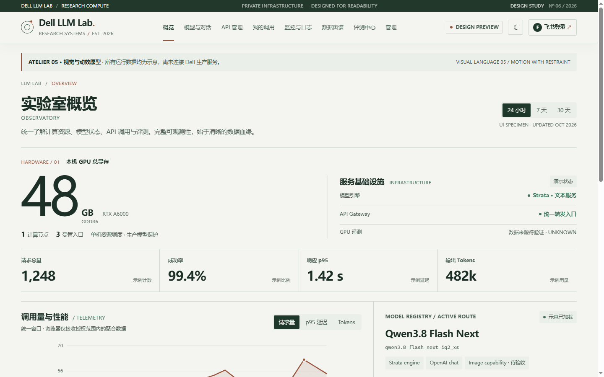
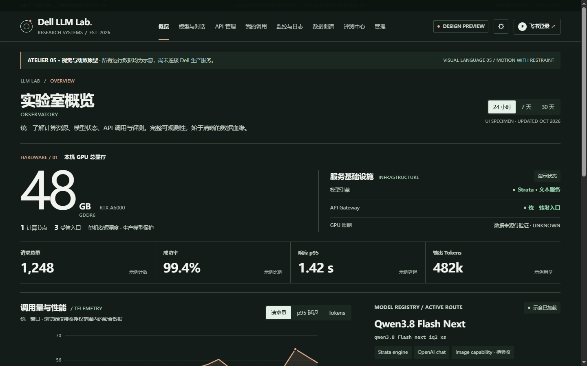
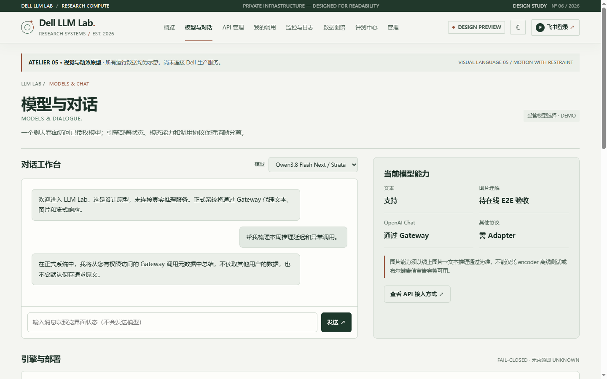
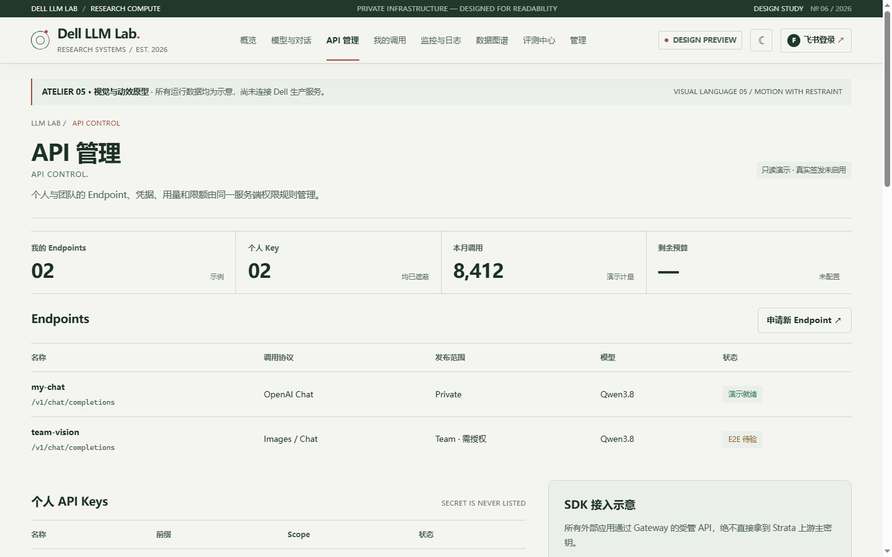
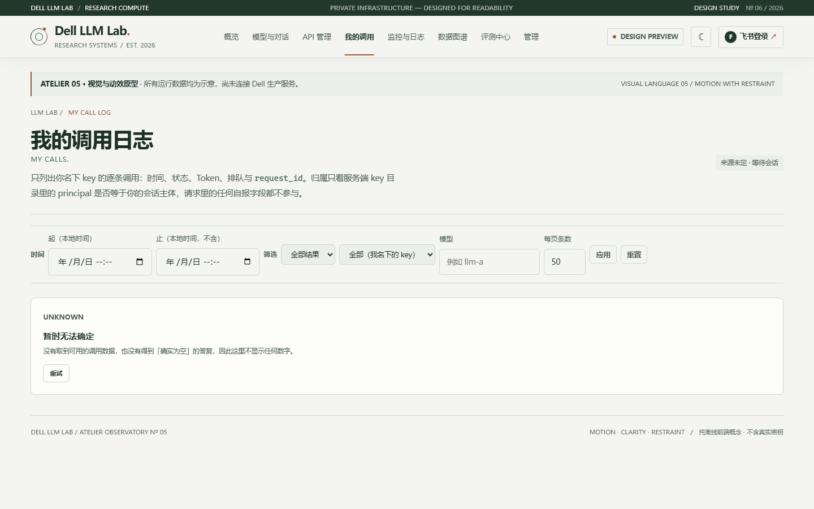
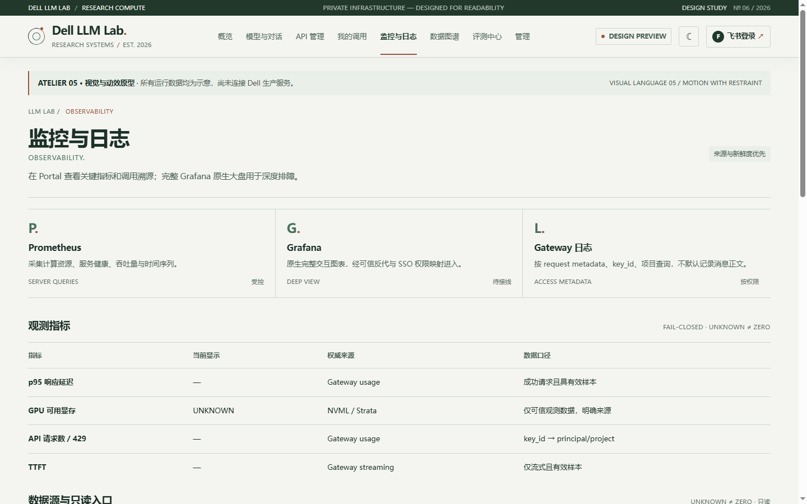
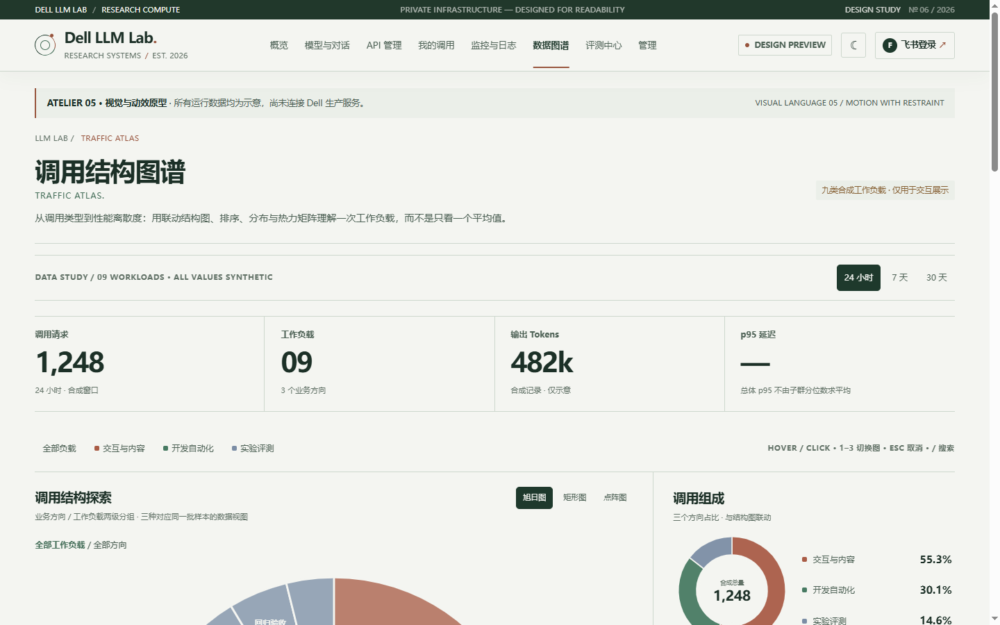
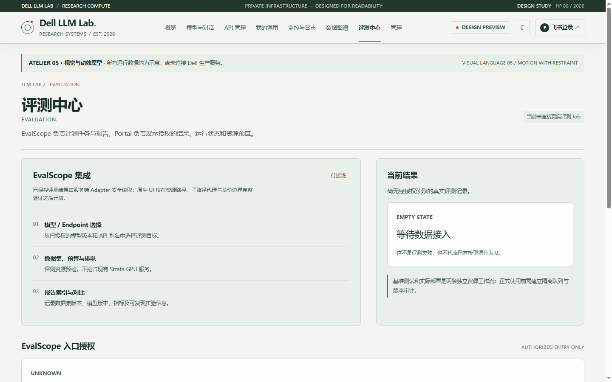
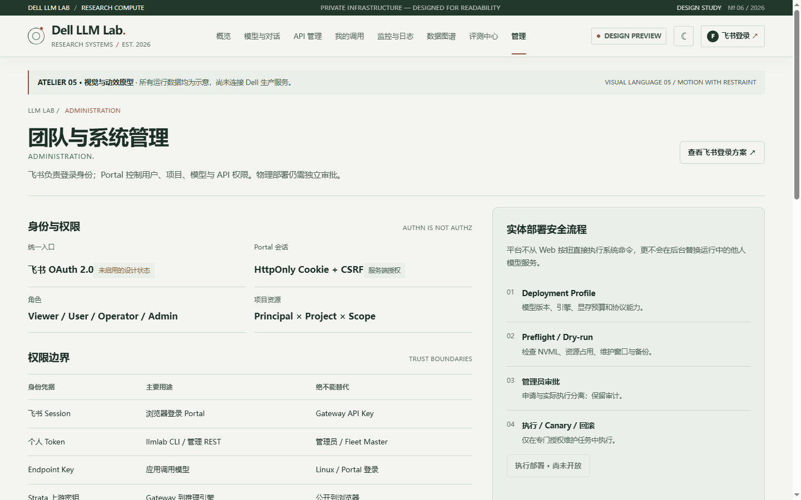

# Atelier V6 frontend screenshot gallery

> **Newer captures:** the V6.1 frontend completion branch has real-browser captures with commit SHA and manifest in [QA_SCREENSHOTS.md](QA_SCREENSHOTS.md). The images below are the *historical* 2026-10-15 before-state.

> **Historical preview evidence, not the current deployed UI or production data.** These PNGs were copied byte-for-byte from the existing GitHub branch [`preview/atelier-v6-captures-20261015`](https://github.com/ProfessorZhi/llm-lab-portal/tree/preview/atelier-v6-captures-20261015), commit `74ee68a9770cca6d313b47dfda08c9c4b836a753`. They are dated **2026-10-15** and can include authored/demo placeholders. They must **not** be presented as today's source-verified production telemetry, IAM access, or live model calls.

**Design authority**: the unmodified, frozen [Atelier V5 prototype](../../prototypes/v5/index.html) and [V5 Atlas notes](../../prototypes/v5/DATA-ATLAS-NOTES.md). V5 comes before historical V6 preview screenshots when design choices conflict. [2027 国考 Observatory](references/guokao-2027-observatory-interactive.html) informs only data visualization and interactions; [Atelier V3](references/atelier-v3-readability-reference.html) informs typography and legibility. See [design reference rules](references/README.md).

## Overview · light / dark

| Light | Dark |
| --- | --- |
|  |  |

## Workspaces · historical previews

| Models | API |
| --- | --- |
|  |  |

| My Calls | Observability |
| --- | --- |
|  |  |

| Traffic Atlas | Evaluation |
| --- | --- |
|  |  |

| Administration |
| --- |
|  |

**Compute subpage is not represented in this 2026-10-15 archive.** Do not invent an existing capture; add an actual screenshot in the next QA pass.

## What Claude Code must capture next

Once Phase II UI improvements are implemented, use an **actual browser**, not a static HTML composition, to capture: Overview, Compute, Models, API, My Calls, Observability, Atlas, Evaluation, and Administration; 1440px desktop and 390px mobile; both light and dark (at minimum Overview, Models, Atlas, Administration in both themes), plus 320/768/1024 responsive checks. Record the exact commit SHA, requested URL/path and `?demo=1` vs default LIVE, browser and viewport, test dataset/provenance, and screenshot timestamp. Store new PNGs in `docs/frontend/screenshots/qa/<commit-sha>/`.

The captured **demo** variant must clearly say **SYNTHETIC / DEMO**. The default variant must show only trustworthy configured facts; otherwise, show **Not Configured**, **No Permission**, **Empty**, **Stale**, or **Error**. Never claim Chrome tests passed if the browser is unavailable.

## Handoff

- [Frontend project context and design references](PROJECT_CONTEXT_AND_DESIGN_REFERENCES.md)
- [Claude frontend implementation prompt (English)](CLAUDE_FRONTEND_IMPLEMENTATION_PROMPT.md)
- [Atelier V6 architecture](../architecture.md)
- [Full nine-page business acceptance issue #56](https://github.com/ProfessorZhi/llm-lab-portal/issues/56)
